<p align="center"></p>

<p align="center"></p>

**Your AI-powered gateway to Japan's top companies**

*Simulate. Score. Succeed.*

---

[](https://nextjs.org/)
[](https://typescriptlang.org/)
[](https://tailwindcss.com/)
[](https://framer.com/motion/)
[](https://react.dev/)

</div>

---

## 🌌 What is MIRU?

**MIRU** (ミル — *to see*, *to observe*) is a full-stack AI interview simulator built for non-native candidates preparing for Japanese corporate interviews. It's not just a chatbot — it's a cultural mirror that shows you exactly how a Toyota, Rakuten, or Sony HR interviewer sees you.

You speak. MIRU listens. It scores your answers across 5 deep cultural dimensions, channels the HR persona of your chosen company, and delivers a forensic debrief that pinpoints exactly where you shone — and where you slipped.

> *"Practice until the interview feels like a conversation, not a test."*

---

## ✨ Features at a Glance

| Feature | Description |
|--------|-------------|
| 🎙️ **Voice-Driven Interview** | Speak naturally — MIRU listens via Web Speech API with auto silence detection |
| 🤖 **AI HR Avatar** | Animated interviewer that reacts to your speech state in real time |
| 🏢 **5 Company Personas** | Toyota, Rakuten, Sony, SoftBank, Uniqlo — each with unique cultural DNA |
| 📊 **Live Cultural Scoring** | 5 Japanese HR dimensions scored turn-by-turn as you speak |
| 🔊 **Text-to-Speech** | ElevenLabs-powered multilingual interviewer voice (EN + JP) |
| 📡 **Real-time Feedback** | Instant radar chart, score bars, and HR debrief post-interview |
| 📄 **CV Integration** | Personalize the interview by uploading your resume |
| 🧠 **Coaching Debrief** | Per-question feedback + rewritten better answers |
| 🖨️ **Print Report** | Download your full analysis as a PDF |

---

## 🗺️ App Architecture & Flow

```
┌─────────────────────────────────────────────────────────────────┐
│  🏠  LANDING  (/)                                               │
│  Hero · Feature Highlights · Company Cards → /onboarding       │
└──────────────────────────┬──────────────────────────────────────┘
                           │
                           ▼
┌─────────────────────────────────────────────────────────────────┐
│  📋  ONBOARDING  (/onboarding)                                  │
│                                                                   │
│  Step 1 ──► Name + Target Role                                  │
│  Step 2 ──► Company Selection                                   │
│             [Toyota] [Rakuten] [Sony] [SoftBank] [Uniqlo]       │
│  Step 3 ──► CV Upload · Language Mode · Duration               │
│                                                                   │
│  [START INTERVIEW] ──► POST /api/session/start                  │
│                    ──► stores in sessionStorage (saiko_*)       │
│                    ──► navigate /interview                      │
└──────────────────────────┬──────────────────────────────────────┘
                           │
                           ▼
┌─────────────────────────────────────────────────────────────────┐
│  🎙️  INTERVIEW  (/interview)                                    │
│                                                                   │
│   State Machine:                                                 │
│   IDLE → STARTING → QUESTION → LISTENING → TRANSCRIBING         │
│                        ▲            │                            │
│                        │            ▼                            │
│                 WRAP_UP ◄── WAITING_RESPONSE ◄──────────────    │
│                    │                                             │
│                    ▼                                             │
│               COMPLETED ──► /debrief?session_id=...            │
│                                                                   │
│   Components:                                                    │
│   • HRAvatar        — state-aware animated interviewer          │
│   • VoiceInput      — mic button + 20-bar waveform              │
│   • Chat Display    — scrolling Q&A transcript                  │
│   • Live Scores     — 5-dimension score cards                   │
│   • Timer           — countdown / elapsed                       │
└──────────────────────────┬──────────────────────────────────────┘
                           │
                           ▼
┌─────────────────────────────────────────────────────────────────┐
│  📊  DEBRIEF  (/debrief)                                        │
│                                                                   │
│   Polls backend → waits for debrief_ready                       │
│                                                                   │
│   Section A — Radar Chart (Candidate vs Ideal)                  │
│   Section B — 5 Score Bars (color-coded)                        │
│   Section C — Interviewer Feedback (strengths + improvements)   │
│   Section D — Coaching Breakdown (per-question analysis)        │
│   Section E — Hiring Signal (Hire / Borderline / No Hire)       │
│   Section F — CTA (Practice Again · Different Company · PDF)    │
└─────────────────────────────────────────────────────────────────┘
```

---

## 🗂️ Project Structure

```
src/
├── app/
│   ├── page.tsx                  🏠 Landing page
│   ├── layout.tsx                🎨 Root layout + fonts
│   ├── onboarding/
│   │   └── page.tsx              📋 3-step onboarding wizard
│   ├── interview/
│   │   └── page.tsx              🎙️ Full-screen interview UI
│   ├── debrief/
│   │   ├── page.tsx              📊 Results wrapper (Suspense)
│   │   └── DebriefContent.tsx    📈 Full debrief analysis
│   └── api/
│       └── interview/
│           └── results/
│               └── route.ts      🔁 Backend results proxy
│
├── components/
│   ├── MiruLogo.tsx              👁️ Animated eye logo
│   ├── HRAvatar.tsx              🤖 State-aware HR animator
│   ├── VoiceInput.tsx            🎙️ Mic + waveform UI
│   ├── GlassCard.tsx             🪟 Glass-morphism card
│   ├── CompanyCard.tsx           🏢 Clickable company selector
│   ├── MiruRadarChart.tsx        📡 Recharts radar overlay
│   ├── ScoreBar.tsx              📊 Animated score progress bar
│   ├── ParticleBackground.tsx    ✨ Canvas star particle system
│   ├── ThemeAwareBackground.tsx  🌌 Dark/light background router
│   └── ErrorBoundary.tsx         🛡️ React error fallback
│
├── lib/
│   ├── types.ts                  📐 All TypeScript data models
│   ├── constants.ts              🗂️ Companies, questions, labels
│   ├── api.ts                    🌐 Backend API client (retry logic)
│   ├── session.ts                💾 SessionStorage wrapper
│   ├── tts.ts                    🔊 ElevenLabs TTS orchestration
│   ├── voice.ts                  🎤 Web Speech API wrapper
│   ├── resultsNormalizer.ts      🔧 Score normalization utilities
│   └── getSessionId.ts           🔑 Session ID resolution
│
└── services/
    └── voice/                    🎵 ElevenLabs audio service
```

---

## 🎭 The 5 Cultural Scoring Dimensions

MIRU doesn't just grade your English — it measures your cultural fluency in real-time:

```
┌──────────────────────────────────────────────────────────────────┐
│                                                                    │
│   和  WA (TEAMWORK HARMONY)           ████████░░  8/10           │
│       "We achieved" vs "I did it"                                │
│                                                                    │
│   忠  LOYALTY & COMMITMENT            ██████░░░░  6/10           │
│       Long-term signals vs job-hopping language                  │
│                                                                    │
│   謙  HUMILITY                        █████████░  9/10           │
│       Crediting the team vs "I am the best"                      │
│                                                                    │
│   改  KAIZEN (GROWTH MINDSET)         ███████░░░  7/10           │
│       Improvement within company vs self-expansion               │
│                                                                    │
│   文  CULTURAL FIT                    ████████░░  8/10           │
│       Company value alignment vs hierarchy blindness             │
│                                                                    │
└──────────────────────────────────────────────────────────────────┘
```

---

## 🏢 Supported Companies

| Company | Persona Highlights |
|---------|-------------------|
| 🚗 **Toyota** | Kaizen-obsessed, long-term loyalty, nemawashi culture |
| 🛍️ **Rakuten** | Englishization, entrepreneurial drive, Rakuten-ism values |
| 🎵 **Sony** | Creative innovation, global mindset, maker culture |
| 📱 **SoftBank** | Visionary disruption, 300-year ambition, speed culture |
| 👕 **Uniqlo** | Craftsmanship, simplicity, global retail excellence |

---

## 🔊 Voice Flow

```
                    🤖 AI generates question
                           │
                           ▼
                    🔊 ElevenLabs TTS plays
                           │
                           ▼
                    🎤 Mic auto-starts
                           │
                    ┌──────┴──────┐
                    │  Speaking   │
                    └──────┬──────┘
                           │ 2.5s silence
                           ▼
                    ✅ Recording stops
                           │
                           ▼
                    📡 Answer → Backend
                           │
                           ▼
                    📊 Scores updated
                           │
                           ▼
                    🤖 Next question generated
                           │
                           └──► loop
```

---

## 🚀 Getting Started

### Prerequisites

- Node.js 18+
- npm / yarn / pnpm
- A running [MIRU Backend](../../../miru-backend) instance

### Installation

```bash
# Clone the repository
git clone <repo-url>
cd miru-frontend/miru-frontend/miru

# Install dependencies
npm install

# Set up environment
cp .env.example .env.local
# Edit .env.local and set NEXT_PUBLIC_API_URL to your backend URL
```

### Environment Variables

```env
# .env.local
NEXT_PUBLIC_API_URL=https://miru-backend-production.up.railway.app
# Or for local development:
# NEXT_PUBLIC_API_URL=http://localhost:8000
```

### Development Server

```bash
npm run dev
```

Open [http://localhost:3000](http://localhost:3000) in your browser.

### Production Build

```bash
npm run build
npm run start
```

---

## 🎨 Design System

### Color Palette

```
#00000A  ──  VOID       Background base (deepest black)
#050818  ──  DEEP       Secondary background
#3B82F6  ──  ELECTRIC   Primary accent (interactions, borders)
#A8B8D8  ──  MUTED BLUE Secondary text / dim elements
#F0F4FF  ──  WHITE      Primary text
#F59E0B  ──  AMBER      Warnings / HR monologue borders
#10B981  ──  GREEN      Positive scores / coaching highlights
#EF4444  ──  RED        Low scores / alerts
```

### Typography

| Token | Font | Usage |
|-------|------|-------|
| `--font-ui` | Space Grotesk | UI labels, body text, scores |
| `--font-display` | Playfair Display | Headers, hero text |

### Glass-morphism Cards

```css
border-radius: 1rem;
border: 1px solid rgba(56, 189, 248, 0.15);
background: rgba(4, 30, 58, 0.7);
padding: 1.5rem;
backdrop-filter: blur(20px);
```

---

## 💾 Session Storage Keys

All session data is stored under the `saiko_*` namespace:

| Key | Value |
|-----|-------|
| `saiko_session_id` | UUID from backend |
| `saiko_company` | `toyota` \| `rakuten` \| `sony` \| `softbank` \| `uniqlo` |
| `saiko_candidate_name` | Candidate's name |
| `saiko_language_mode` | `en` \| `jp` |
| `saiko_duration_minutes` | `3` \| `10` \| `15` \| `30` \| `60` |
| `saiko_cv_data` | Extracted CV text |
| `saiko_transcript` | Serialized Q&A history |
| `saiko_scores` | Latest dimension scores |
| `saiko_debrief` | Final results cache |

---

## 🛠️ Tech Stack

| Layer | Technology |
|-------|-----------|
| Framework | Next.js 16 (App Router) |
| Language | TypeScript 5 (strict mode) |
| Styling | Tailwind CSS v4 + CSS variables |
| Animation | Framer Motion 12 |
| Charts | Recharts 3 |
| Icons | Lucide React (individual imports) |
| Fonts | Space Grotesk + Playfair Display (next/font) |
| Voice Input | Web Speech API |
| Voice Output | ElevenLabs TTS |
| State | React useReducer + sessionStorage |
| HTTP | fetch + AbortController (20s timeout, 3× retry) |

---

## 🔗 Backend Connection

MIRU Frontend communicates with the MIRU Backend via REST:

| Method | Endpoint | Purpose |
|--------|----------|---------|
| `POST` | `/api/session/start` | Create interview session |
| `POST` | `/api/interview/turn` | Submit answer, get next question |
| `GET` | `/api/interview/results?session_id=` | Poll for final results |
| `GET` | `/api/interview/{id}/radar` | Radar chart scores |
| `GET` | `/api/interview/{id}/feedback` | Per-question coaching |
| `GET` | `/api/interview/{id}/transcript` | Full Q&A history |

> ⚠️ **Navigation Guard**: Always check `data.interview_complete && data.debrief_ready` before navigating to `/debrief`. Never navigate on `interview_complete` alone.

---

## 📦 Key Dependencies

```json
{
  "next": "16.1.6",
  "react": "19.2.3",
  "framer-motion": "^12.36.0",
  "recharts": "^3.8.0",
  "tailwindcss": "^4.0.0"
}
```

---

## 🌐 Deployment

MIRU Frontend is optimized for **Vercel** deployment:

```bash
# Via Vercel CLI
vercel --prod

# Or connect your GitHub repo to Vercel dashboard
# Set NEXT_PUBLIC_API_URL in environment variables
```

---

## 📄 License

MIT License — built with 💙 for cultural bridges.

---

<div align="center">

**ミル — See yourself through their eyes.**

*Toyota · Rakuten · Sony · SoftBank · Uniqlo*

</div>

<p align="center"></p>

<p align="center"><sub>Built by <a href="https://github.com/sameermotwani17-cell">Sameer Motwani</a> · <a href="https://portfolio-sameermotwani17-cells-projects.vercel.app">portfolio</a></sub></p>

<p align="center"></p>

<p align="center"><sub>Built by <a href="https://github.com/sameermotwani17-cell">Sameer Motwani</a> · <a href="https://xsofficialbrand.com">portfolio</a></sub></p>
